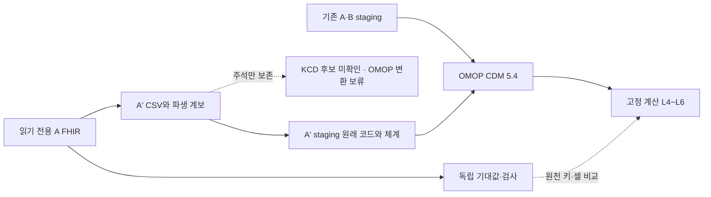

# 설계 03 · A′ — 입력 모양을 바꾸고 원값·계산은 보존

- 상태: 2026-10-22 v3 사전 검수 수용 · 8파일 고정 · 원래 임상 경로 최종 검수 수용·완료(52726ab)
- 담당: 의료 Codex · 별도 사전/최종 검수: 방법 감독
- 기준: `8d09142`, 고정 계산 기준 `3e99c30`, D1~D7·결정 0004~0011·[0013](../decisions/0013-a-prime-derived-source-and-precision.md)

## 목표와 범위

A/B를 유지하고 `A_PRIME`을 A의 파생 논리 출처로 추가한다. A′의 문자열·코드를 해석한 뒤 같은 OMOP 임상 사실과 출처별 지표를 얻는지 확인한다. 전체 FHIR의 약·기관·청구 등 모든 자원을 새 청구 테이블로 바꾸는 작업은 아니다. 기존 범위의 사람 36명, 진단 1,455행, 방문 2,144행, 혈압 555묶음/1,110성분의 사실을 보존하고 나머지는 읽기 전용 FHIR에 남는다.

G1 파생 출처 병렬, G2 소수 원값 전체 보존·프로젝트 확장, G3 A′ 뒤 별도 SQL 준비는 수용됐다. 공개 push·설치·유료 호출·성능 입력 생성·계산 모델 변경은 하지 않는다. 공식 CMS165나 실제 보험청구 전체의 구현을 주장하지 않는다.

## 데이터 모양

실선의 원래 임상 경로는 제품에서 실행했다. 점선의 KCD 후보는 주석으로만 남고 KCD→OMOP 연결은 없다. 기대값 생성 경로는 제품 exporter·staging·DB를 입력으로 쓰지 않는다.

새 입력의 기본 위치는 Git에서 제외한 `data/a_prime/`다. 생성기는 원본을 읽기만 하며 같은 입력 재시도는 해시 확인 후 재사용하고, 다른 입력·다른 내용의 기존 출력을 덮지 않는다. 수신시각을 임상 날짜로 바꾸지 않는다.

| 파일·한 행·키 | 보존 필드·표현 | 해석 책임 |
|---|---|---|
| `persons.csv`: 사람, `person_id` | 원래 전체 id, 생년월일, 성별, 사망 정보, 측정 연도 2025, `derived_from=A` | staging은 태어난 해·사실만 제공. 기간·나이·제외는 계산 정의 유지 |
| `diagnoses.csv`: Condition×coding, `(condition_id, coding_index)` | 원래 사람/진단 키·`original_code`·`original_system`·시작/종료/기록 날짜 원문·상태. KCD 후보·판 맥락·미확인 상태는 아래 별도 열 | 원래 SNOMED 임상 경로와 후보 주석을 분리. 원래 의미의 연결은 검수·고정 뒤, KCD에서 의미를 얻는 경로는 계속 보류 |
| `visits.csv`: 방문, `encounter_id` | 원래 키·class code/system·시작/끝/기록 날짜 원문. 프로젝트 종류 OP/IP/ER/HH/VR를 원래 class와 함께 보존 | source 전용 staging에서 AMB/IMP/EMER/HH/VR 대응. HH/VR도 행은 유지하고 승인된 개념 0 유지 |
| `bp_details.csv`: panel, `observation_id` | 사람/측정 키·임상 날짜 원문·status·panel code/system과 전체 coding 쌍·`bp_text`·성분 코드/system·원래 숫자/단위 code/system/unit. 형식 상태 `integer_pair` 또는 `decimal_extension` | 제품은 문자열을 독립 파싱하고 원래 성분값·namespace와 대조. 소수·부분값·단위 미대응을 숨기지 않음 |
| `manifest.json`: 생성 입력 묶음 | 원본 해시, 열 계약, 건수, 코드/단위 상태, 파생 관계, 정수/확장 건수 | 입력 바뀜·중복·누락·불일치를 로더/검사에서 거부 |

`bp_text`는 파일 내 component 순서와 무관하게 코드로 수축기/이완기를 정한다. `124/92`와 `109.51/76.761`을 정확한 십진수 값으로 보존한다. 빈 성분은 빈 쪽으로 표현하고 잘못된 추가 구분자는 거부한다. JSON 숫자의 표기 공백·지수 철자까지 같은 바이트로 복제한다는 계약은 아니다. 원본 파일의 SHA256을 유지하고 숫자의 정확한 값과 소수 자릿수를 보존한다.

모든 날짜는 원문의 앞 10글자를 사용하고 시간대 변환하지 않는다. 원래 timestamp 전체도 입력에 남긴다. `record_day`와 임상일의 차이는 기존 0006 거부 계약을 유지한다. 입원·응급 기간은 끝 포함이며 끝이 없으면 시작일 하루다. status를 보존하되 새 상태 필터를 추가하지 않는다. 진단 1,455행 중 기존 매핑 범위 밖 1,445행을 없애지 않고 명시적으로 미대응 집계한다.

### R01 · 새 기준의 코드 체계와 보존

이 표는 새 계산기·projection 계약의 고정 전 보완이며 기존 A/B 제품·seed·정의의 수정이 아니다. 원천의 URI를 고쳐 맞추거나 확인하지 않은 namespace 별칭을 추가하지 않는다.

| 대상 | 이 새 기준에서 수용한 namespace·코드 | 다른/없는 namespace의 같은 문자열 |
|---|---|---|
| 고혈압 | `http://snomed.info/sct` + `59621000` → 기존 기준 320128 | 원천 진단과 hash·미대응 수에 남기며 고혈압 이관/대상 판단에 쓰지 않음 |
| 혈압 panel | `http://loinc.org` + `85354-9` | 원천 후보를 보존하고 BP 표준 의미를 부여하지 않음 |
| 수축기/이완기 | `http://loinc.org` + `8480-6`/`8462-4`, 수용한 panel 안의 성분 | 성분 행·값을 남기고 표준 개념 0, 지표 BP에서 제외 |
| 단위 | `http://unitsofmeasure.org` + `mm[Hg]` | 단위 원문을 보존하고 unit concept0. 표시값 `mmHg`를 code로 추측하지 않음 |
| 방문 | `http://terminology.hl7.org/CodeSystem/v3-ActCode` + AMB/IMP/EMER/HH/VR | 방문 행·기간·class 원문을 보존하고 concept0. 외래/입원/응급 의미를 추측하지 않음 |

성별은 별도 system 필드가 없는 Patient.gender 원시 값이며 기존 male/female의 수용 범위만 사용한다. 원천 1,455진단에는 SNOMED 1,425·ICD-10 30이 있고, 후자를 SNOMED로 바꾸거나 새 매핑하지 않는다. 실제 panel555·성분1,110은 LOINC, 단위1,110은 UCUM, 방문2,144는 위 ActCode URI로 확인했다.

panel의 첫 `85354-9` 후보 code/system을 각각 `panel_code`·`panel_system`으로 보존한다. 전체 원래 panel coding의 code/system 쌍도 배열 순서 그대로 정렬-key JSON 문자열 `panel_codings`에 남긴다. 수용한 panel의 의미는 전체 coding 중 정확한 LOINC 쌍이 존재하는지로 확인한다. 모든 성분의 원천 사실 hash에 이 세 필드를 포함해 panel namespace만 바뀌어도 식별한다. R01의 manifest v2는 기존 원천 key4,745개를 유지하고 BP 성분1,110개 digest만 바꿨다. 아래 v3의 경로 상태 분리는 이 v2의 projection·CSV를 유지한다. 이 보완은 KCD→OMOP 근거를 닫지 않는다.

## 원래 임상 의미와 KCD 후보의 기술 경계

수용된 구현 경로는 `preserved_source_clinical`이다. 원래 FHIR의 코드와 체계를 A′ 입력 안에 남기고, 그 보존 필드로 승인된 기존 의미를 다시 해석한다. KCD 후보는 입력에 추가한 프로젝트 주석이며 임상 의미의 입력이 아니다. 이 경계의 v3 사전 검수와 고정 후 구현을 거쳐 제품 `52726ab`의 원래 임상 의미 보존 범위를 최종 수용했다. 수용 근거와 보류 범위는 [결정 0013](../decisions/0013-a-prime-derived-source-and-precision.md#최종-수용2026-10-22)에 있다.

| 구분 | 입력/상태 | 읽는 곳과 금지한 의존 |
|---|---|---|
| 원래 진단 사실 | `original_code`, `original_system`, 원천 키·coding_index·날짜·상태 | FHIR에서 그대로 보존. source projection과 입력/staging 양쪽에서 비교. 비어 있거나 다른 체계이면 후보로 보충하지 않음 |
| 원래 임상 경로 | 정확한 `http://snomed.info/sct` + `59621000` → 기존320128, 근거0009 | `stg_aprime_diagnosis.source_code=original_code`. 원래 system이 SNOMED일 때만 `source_vocabulary_id=hospital_a_prime_dx_snomed`, 그 밖은 새 미대응 구분 `hospital_a_prime_dx_unmapped`. 이 구분+원래 코드로 OMOP join |
| 후보 주석 | `kcd_candidate_code=I109`, `kcd_candidate_edition_context=KCD-8`, `kcd_candidate_status=unverified`, `kcd_candidate_usage=annotation_only` | 정확한 원래 SNOMED 고혈압 행에만 프로젝트 후보를 표기, 그 밖은 후보 공란·상태not_assigned. KCD-8은2025 측정 맥락이고 원래 과거 진단의 실제 청구 판을 주장하지 않음 |
| KCD에서 얻는 임상 의미 | 정규화·vocabulary 배포 판·관계·표준 개념의 근거 미확인 | 구현/seed 매핑 보류. `I109`/`I10.9`를 SNOMED로 치환하거나 B의 ICD-10 대응으로 추정하지 않음 |

원래 진단1,455행은 staging/미대응 수에 남기고 승인된 고혈압10행만 기존 의미로 이관한다. 원래 system이 다른59621000과 원래 코드가 없는 I109 후보는 개념320128/대상 판정으로 들어가지 않는다. `source_vocabulary_id`는 프로젝트 매핑 구분이며 실제 원래 URI를 대신 보존하는 필드가 아니다. URI는 별도 원래 필드와 projection에 계속 남긴다.

허용할 seed 추가 후보는 `(hospital_a_prime_dx_snomed,59621000) →320128`뿐이다. KCD 후보로 fallback하는 `coalesce(original_code,kcd_candidate_code)`나 후보를 `source_code`/`condition_source_value`에 넣는 변환은 금지한다. OMOP의 진단 원천값은59621000을 유지하며 별도 candidate 열을 공식 CDM 열로 추가하지 않는다. 원래 코드/체계는 원천 키로 staging까지 추적하고 후보는 입력/새 staging의 별도 열에서만 확인한다. L4~L6·지표 개념 seed는 후보를 읽지 않는다.

후속 구현의 완료 주장도 **A′ 문자열 입력·원래 임상 의미의 보존/동등성**으로 한정한다. 새 청구 코드에서 개념을 복원하는 호환성·KCD 연동·실제 청구 규정 전체 준수는 완료 범위가 아니다. KCD 사실 미확인을 이 경로의 성공으로 해소했다고 쓰지 않는다.

### manifest와 검사기의 경로별 판정

고정한 manifest v3는 `mapping.comparison_route=preserved_source_clinical`, `mapping.clinical_basis`, `mapping.kcd_candidate`를 분리한다. `clinical_basis.status=accepted_existing_source_mapping`은 기존0009의 의미 수용을 뜻하며 A′ 제품 구현/감독 검수 수용 상태가 아니다. 이 객체에는 원래 system/code·목표320128·결정0009·`uses_kcd_candidate=false`를 기록한다.

`kcd_candidate`에는 후보 I109·측정 맥락 KCD-8과 `usage=annotation_only`만 기록한다. `kcd_dot_normalization`·`kcd_to_omop`·`mt056_decimal_supplement`는unverified, `product_mapping_gate`는blocked로 유지한다. vocabulary_release·mapping_relationship는공란, target_concept_id는NULL이다. 확인되지 않은 KCD 목표 개념을 먼저 기입하지 않는다.

| 검사 선택/조건 | 결과 의미 |
|---|---|
| `--route preserved_source_clinical`, 원래 승인된 basis·모든 CSV/원천 사실 동일 | 임상 보존 비교의 `ok=true` 가능. KCD는blocked/unverified·`kcd_route_ok=false`로 함께 반환 |
| 원래 code/system·basis가 다름/누락, 후보만 있음 | 값이 같아도 임상 경로ok=false. 후보 문자열로 basis를 보충하지 않음 |
| `--route kcd_to_omop` | 현 계약에서는 항상ok=false. 이 선택은 미지원 경로의 거부 검사이며 KCD 구현 기능이 아님 |
| KCD 상태만verified/approved로 바꾸거나 목표를 주장 | 현 미확인 계약과 모순으로 실패. 원래 의미의 성공을 위해 상태를 조작하지 않음 |
| 같은 basis이나 CSV/projection 불일치 | data_equal=false·ok=false. 경로 구분이 데이터 검사를 약화하지 않음 |

CLI는 경로를 반드시 명시하고 먼저 기존 새 기대값의 해시/읽기 전용 고정을 확인한다. 승인된 8파일/목록0444·디렉터리0555 고정과 verify_lock을 통과했고 실제 임상 CLI는 종료0, KCD CLI는 종료1이다. 수기 단위 시험의 비교 함수 성공은 경로별 검사 조건의 확인이다. 감독이 수용한 정확한 파일을 2026-10-22 01:40:55 KST에 고정하고 구현을 시작했다. KCD 매핑 의존 변경은 그때도 계속 보류한다.

## 독립 기대값과 비교 계약

`answer_key_a_prime/calculate.py`는 Python 표준 라이브러리만 사용한다. 원본 FHIR의 Patient/Condition/Encounter/혈압 panel을 직접 읽고 D1~D7과 승인된 기존 개념 의미로 계산한다. 제품 모듈·exporter·staging·DB 출력·기존 기대 CSV는 계산 입력으로 쓰지 않는다. JSON 숫자는 Decimal로 읽고 성분 최솟값과 경계 비교도 Decimal로 계산한다.

| 새 파일 | 행 단위·키·검증 |
|---|---|
| `expected_a_prime/person.csv` | 출처×기준 라벨×대상 사람. 열은 기존 사람별 계약과 같고 출처만 `A_PRIME`. 실제 기준일·마지막 날짜·값·사유까지 비교 |
| `expected_a_prime/summary.csv` | 출처×기준 라벨. 출처별 분모·분자·소수 4자리 반올림 비율. 대상 0명이어도 사람이 있는 출처의 기준 시점 행을 유지하고 rate는 NULL |
| `expected_a_prime/omop_facts.csv` | 출처×OMOP 테이블×원천 행 키. 사람·확장·관찰 기간·방문·고혈압 진단·혈압 성분의 의미 있는 날짜/개념/값/단위·원래 코드. 사건의 가변 정수 ID로 비교하지 않음 |
| `expected_a_prime/manifest.json` | 원본 파일 해시(기관/환자 이름을 포함한 파일명은 기록하지 않음), 포함/미대응 수, 소수 건수, 정의/매핑 근거와 상태. 선택한 원천 사실 전체의 정규화 행 해시도 포함 |
| `expected_a_prime/SHA256SUMS` | 수용된 새 CSV/manifest와 계산·검사·시험·설명8파일 포함. 루트 기준 목록 SHA b3a34cb6edc90511cd7e5eae910011d00ff7ba7d0169da5fdf0d62d26a40dec2. 파일/목록0444·디렉터리0555 |
| `answer_key_a_prime/check.py` | CSV 형식·NULL·키·행·셀/원천 사실 해시 대조. data_equal·원래 임상 basis·KCD 미지원 상태를 분리하고 실제 파일 alias·JSON 중복 필드를 거부. 기대값 재작성 없음 |
| `answer_key_a_prime/test_contract.py` | 원천을 닮은 수기 소형 입력의 계산 확인과, 약속 하나씩 바꾼 결과를 검사기가 거부하는 mutation. 이 추가 파일 경로도 검수·고정 대상 |

임상 사실 CSV의 `reference_code`·`reference_system`은 변환 전 A를 가리킨다. 진단 320128은 기존 SNOMED `59621000`의 승인된 기준값이다. **`I109`의 공식 매핑을 확인했다는 출력이 아니다.** manifest의 KCD gate는 `unverified`로 남으며, 이 상태에서 KCD→OMOP 제품 매핑을 고정·구현하지 않는다. 임상 기대값을 미리 계산하는 것과 새 원천 코드 매핑 수용을 분리한다.

현재 KCD의blocked/unverified는 `mapping.kcd_candidate` 안에서 유지한다. 앞선 검사기에서 모든 성공에 KCD verified를 요구했던 조건은 감독의 경로 구분 지시에 따라 고정 전에 대체했다. `data_equal`은 값 일치, `ok`는 명시한 임상 경로의 basis·후보의 정직한 미확인 상태·데이터 일치만 뜻한다. KCD 성공이나 제품 구현 수용으로 확대하지 않는다. 실제 CSV가 기대 파일 자체·symlink·hardlink이면 거부하고 JSON 중복 필드는 마지막 값만 읽어 통과시키지 않는다.

검사 입력은 새 실제 CSV 세 개와 실제 원천 사실 projection JSONL이다. projection은 `kind`, `source_row_key`, `facts`만 갖고 원래 키/날짜/코드/system/정확한 값/단위/status를 포함한다. 제품 구현 때 A′ 입력과 staging 결과에서 각각 추출해 같은 manifest와 비교한다. 원천 FHIR를 그대로 읽어 projection만 복사하는 경로를 제품 검증으로 쓰지 않는다. 제품의 문자열 해석을 깨뜨리는 통합 반례는 구현 단계에서 추가한다.

## 완료 조건과 반례

1. A/B의 기존 보호 파일·임상 사실·환자별/요약 결과가 유지된다. `FROZEN_BASE=3e99c30`과 고정 경로 diff 0이다. 새 `A_PRIME`을 A/B와 합산하지 않는다.
2. A′ 사람 36·방문 2,144·고혈압 진단 기준 10·혈압 성분 1,110행을 원천 키별로 대조한다. 원천 진단 1,455행과 소수 panel 5/성분 10을 별도로 확인한다. 원천 행 해시는 누락·증폭·값/단위/날짜/코드 손실을 거부한다.
3. 기대 조절률 3/5→4/6은 원천 직접 계산으로 확인하고, 제품 구현 뒤 실제 결과와 셀 단위 비교한다. 실제 제품 비교에서도 같음을 확인하며 최종 감독 수용과 구분한다.
4. 수기 입력과 mutation은 성분 반전, 소수 반올림, 원천 행 누락/중복, 입원/응급 제외 누락, 같은 날 최솟값, 마지막 유효일, 140/90 경계, 부분값/혈압 없음, 분모 0, 파생 출처 합산, 늦은 기록일을 각각 확인한다. 빈 실제 파일·잘못된 숫자/날짜 형식도 거부한다. CSV는 셀의 형식·값을 확인하며 실제 SQL 자료형 검사는 기존 확인 사다리의 별도 책임이다.
5. 감독 사전 검수 → 수정 완료 → 새 기대값·검사기·해시/디렉터리 읽기 전용 고정 → 제품 구현 순서다. 최종에는 `sh scripts/check.sh`와 새 검사 출력, A/B 전후 두 방향 EXCEPT ALL, 실제 크기/시간/한계를 남긴다. 사전 검수 준비 당시의 새 계산은 DB를 입력으로 쓰지 않았고 기존 검사 통과만으로 A′ 성공을 주장하지 않았다. 고정 후에는 생성 입력과 staging의 별도 projection·실제 OMOP/지표 결과 비교를 검사 ⑦로 연결했다.

### 로컬 검증 결과와 한계

제품 시험 116개(기존 100개와 새 16개), dbt 실행 186개, 확인 사다리 ①~⑦이 통과했다. 입력·staging 각각의 원천 사실 4,745개, OMOP 사실 3,372행, 사람별 11행과 요약 2행이 고정 기준과 같다. A/B의 임상 사실·지표 9테이블은 원래 키를 기준으로 전후 두 방향 EXCEPT ALL이 모두 0행이다. 기존 보호 145파일의 내용·모드와 고정 계산 diff도 차이가 없다.

새 수기 입력은 다른 진단/방문/panel/성분/단위 체계, 후보만 있는 진단, 소수와 부분값, 같은 날 최솟값, 마지막 유효일, 입원 마지막 날 제외를 실제 SQL로 확인한다. 원본에 없는 분기의 시험이며 실제 환자 분포의 관측과 구분한다. 문자열/해시 불일치와 늦은 기록일은 SQL 전에 거부하고, staging 값 변조는 실제 추출기가 거부한다. 출력 경로 alias와 이전 성공 보고의 잔존도 별도 시험한다.

로컬 새 복제본에서 기존 설치와 43개 원천만 재사용한 오프라인 quickstart를 두 번 통과했다(101.38초·100.03초, 새 다운로드 0). 두 번째 실행에서 생성 입력 5파일의 해시·바이트·수정 시각은 같다. 첫 복제본 실행은 시험 로그의 부모 폴더가 없어 실패했고 해당 시험의 폴더 생성 한 줄만 보완했다. 마지막 두 번의 성공은 그 수정이 들어간 코드다. 인터넷 설치를 새로 검증하거나 KCD 경로를 수용한 결과가 아니다. 원래 임상 의미 보존 범위는 R02/C01 보완과 실제 저장값 독립 대조 A01/A02를 포함해 방법 감독이 제품 `52726ab`로 최종 수용했다. SQL/차원 모델링은 준비된 계획/예상 결과까지이며 현재 승인 범위의 잔여 실행은 없다.

## 허용 변경 경로와 보류

새 기대값 작성/사전 검수는 완료했다. `answer_key_a_prime/`·`expected_a_prime/`의 고정8파일과 목록은 수정·권한 해제하지 않는다. 이 설계·결정과 의료 작업실의 현행 상태/검증 근거를 갱신한다. 기존 `answer_key/` 계산 코드는 열지 않는다.

검수·고정 뒤 수용된 제품 경로: 입력 생성 모듈/CLI, `models/staging/hospital_a_prime/`, 새 source 정의, `models/omop/omop_people.sql`·`omop_diagnoses.sql`·`omop_event_rows.sql`의 단순 이음, `source_to_concept_map`의 승인된 새 출처 행, 출처/적재 건수 표시, 새 checker 연결과 시험. 아래 파일 표의 범위로 구현하며 KCD 의존 부분은 계속 보류한다. 공식 OMOP 열·뜻과 기존 개념 seed·계산 모델은 유지한다.

| 수용된 변경 허용 파일 | 이유·정의 |
|---|---|
| `fhir_line/a_prime.py`, `fhir_line/__main__.py` | 새 입력 생성/해시·파생 관계·재시도. 원본 쓰기 금지. D1·결정 0013 |
| `fhir_line/runtime.py` | 기존 보호 경로를 유지하고 `expected_a_prime/`·`answer_key_a_prime/`에 일반 출력/DB 쓰기가 들어가지 못하게 경로 검사를 연결. symlink 해석 뒤에도 거부. 계산 정의 변경 없음 |
| `models/staging/hospital_a_prime/sources.yml`, `schema.yml`, `stg_aprime_person.sql`, `stg_aprime_diagnosis.sql`, `stg_aprime_visit.sql`, `stg_aprime_bp_value.sql` | 새 출처만의 모양/날짜/문자열 해석과 키·필수값·날짜 검사. D1~D3·0006·0013 |
| `models/omop/omop_people.sql`, `omop_diagnoses.sql`, `omop_event_rows.sql` | 새 staging의 단순 이음. 날짜·나이·대상 판단 추가 없음. 0004·0005·0010 |
| `seeds/source_to_concept_map.csv` | 원래 체계를 확인한 새 출처 namespace 행만 추가. 진단은 `(hospital_a_prime_dx_snomed,59621000) →320128`, 미대응 namespace 매핑 없음. I109/I10.9 행은 보류. 0009·0013 |
| `models/omop/cdm_source.sql`, `omop_load_counts.sql`, `schema.yml` | 출처 표시/적재 건수·새 키·미대응 검사. 공식 열과 기존 A/B 의미 유지 |
| `fhir_line/a_prime_checks.py`, `scripts/check.sh`, `tests/test_a_prime.py` | 새 실제 CSV/projection 추출·잠금/값 비교·생성/파싱 통합 반례. 기존 검사 삭제·고정 기준 변경 없음 |
| `fhir_line/omop.py`, `fhir_line/ladder.py` | 기존 A/B 건수·초과 출처 거부 검사를 유지하면서 승인·고정한 새 A′ 기대 건수만 명시적으로 함께 비교. 등록 안 된 병원을 무시하지 않음 |
| `.gitignore` | 생성 원천 `data/a_prime/`를 Git에서 제외. 새 기대 CSV/검사 코드는 제외하지 않음 |
| `scripts/quickstart.sh`, `scripts/source_data.py`, `tests/test_quickstart.py` | 새 입력 생성·새 고정 경로 해시 확인/쓰기 비트 제거·검사/독립 재계산을 기존 명령 하나에 연결. 기존 A/B 재계산·보호는 유지하고 새 설치/다운로드는 추가하지 않음 |
| `README.md`, `docs/pipeline.md`, `docs/data-dictionary.md` | 구현 후 실제 지원 범위·명령·열 계약만 반영 |

이 표는 구현 배정에서 수용한 변경 허용 범위다. 제품 입력 기본 경로는 `data/a_prime/`, 시험 입력 override는 `A_PRIME_SOURCE_DIR`다. 소스 읽기는 기존 DuckDB CSV reader·`all_varchar`와 현재 자원 제한을 사용하며 새 패키지·extension을 받지 않는다.

기존 OMOP 건수 검사는 A/B 기대 목록 밖의 출처를 실패시킨다. 새 출처 때문에 그 검사를 삭제하거나 A′를 무시하지 않고, 새 고정 manifest의 건수/미대응을 명시적으로 결합하는 방식으로 확장해야 한다. 새 경로가 있다는 사실만으로 활성화하지 않고 검수·고정·선택한 원래 임상 basis·실제 연결 상태를 확인한다. KCD 후보를 포함했다는 이유로 KCD 매핑을 활성화하지 않는다. 새 복제본에서는 Git이 읽기 전용 비트를 보존하지 않으므로 새 기대값/계산·검사 코드도 해시가 먼저 맞는지 확인한 뒤 쓰기 비트를 제거해야 한다. 기존 보호 경로의 권한 해제는 하지 않는다.

고정 전의 phase/준비 설명은 snapshot 바이트로 남긴다. 현재 고정 상태는 해시·파일/디렉터리 모드와 verify_lock으로 확인하며 고정 후 기대값을 수정하거나 권한을 풀지 않는다. 매핑 근거가 닫히지 않으면 그것에 의존하는 제품 부분만 계속 보류하며 감독에게 반환한다.

## 근거와 남은 미확인

- [KCD-8 개정·고시](https://kostat.go.kr/boardDownload.es?bid=246&list_no=383272&seq=1), 2020-07-01·PDF 1페이지: 시행 2021-01-01. [KCD-9 고시 제2025-299호](https://www.kostat.go.kr/boardDownload.es?bid=107&list_no=437419&seq=1), 2025-07-01·PDF 1페이지: 시행 2026-01-01. 2025년 시점의 판과 현재 판을 구분한다.
- [HIRA 2025 계획](https://www.hira.or.kr/bbs/157/2024/12/BZ202412270979284.pdf), 2024-12·PDF 25페이지/인쇄 21쪽: `I109` 예시·MT056 `9(3)/9(3)`. [분석심사 지침](https://www.hira.or.kr/bbs/157/2024/08/BZ202408070337506.pdf), 2024.8·PDF 42/45페이지, [평가결과 작성요령](https://www.hira.or.kr/cms/open/04/04/12/2025_1.pdf), 2025.12·PDF 93페이지도 확인했으나 해당 절에서 소수 처리 규칙은 확보 못 했다. 모든 규정의 금지로 일반화하지 않는다.
- 확인일 2026-10-21. `I10.9` KCD-8 원문 행·점 정규화 규칙과 vocabulary 배포 판/`Maps to`/목표 standard concept의 연결은 미확인이다. Athena 공개 조회는 403이었다. 기존 SNOMED 및 B ICD 매핑으로 이를 대신하지 않는다.
- 같은 담당이 기대값과 제품을 시간·계산 경로로 분리해 작성하는 한계가 있다. 원천 직접 계산·수기 입력·별도 감독 검수로 보완하며 다른 AI나 고추론 설정 자체를 독립 근거로 쓰지 않는다.
